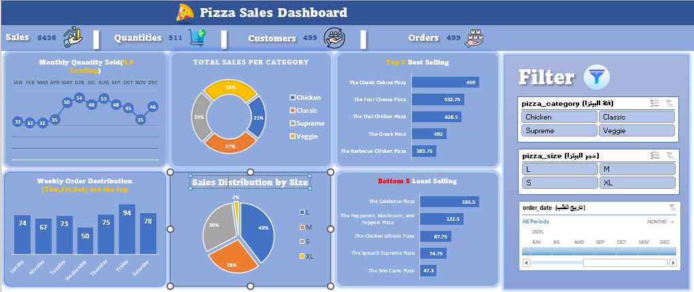
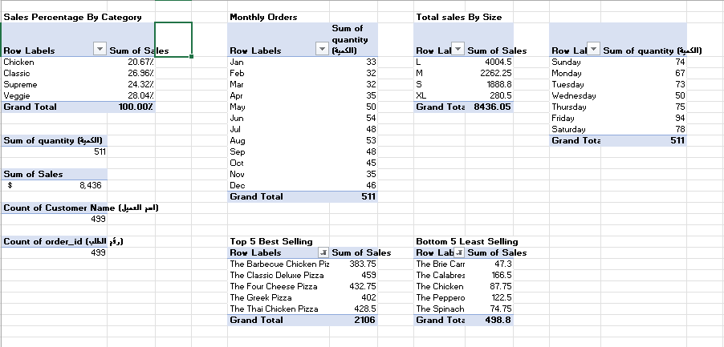

# 🍕 Pizza Sales Dashboard — Excel

An interactive sales dashboard built entirely in **Microsoft Excel** using **PivotTables, PivotCharts and Slicers**. It turns raw pizza order data into a one-page view of sales performance, customer demand and product ranking.



---

## 📌 Project Overview

This project was completed as part of a data analysis training course. The goal was to clean and model order data, summarize it with PivotTables, and present the results in a clear, interactive dashboard that a business owner could use to make decisions.

**Business questions answered:**

- How much revenue and how many orders/customers did we have?
- Which months and days of the week are busiest?
- Which pizza categories and sizes drive the most sales?
- What are the best-selling and least-selling pizzas?

---

## 📊 Key Metrics

| Metric | Value |
|---|---|
| Total Sales | **$8,436** |
| Total Quantities Sold | **511** |
| Customers | **499** |
| Orders | **499** |

---

## 🔍 Key Insights

**1. Every customer ordered once.**
There are **499 customers and 499 orders**, so no customer appears to have returned. Average order value is about **$16.91** ($8,436 ÷ 499), with roughly 1.02 pizzas per order.

**2. Demand peaks from Thursday to Saturday.**
**Friday (94 pizzas)** is the busiest day, followed by Saturday (78) and Thursday (75). Together these three days make up **48%** of all units sold. Wednesday is the slowest day (50).

**3. Sales are seasonal.**
Monthly quantity peaks in **June (54)** and stays high from May to September (48 to 54 per month). It is lowest in **February and March (32)**, and November is also low (35).

**4. Veggie and Classic lead by category.**
Veggie contributes **28.0%** of sales and Classic **27.0%**, followed by Supreme (24.3%) and Chicken (20.7%).

**5. A few pizzas carry the menu.**
The top 5 pizzas (Classic Deluxe, Four Cheese, Thai Chicken, Greek, Barbecue Chicken) generate about **25%** of sales ($2,106). The bottom 5 (Brie Carre, Spinach Supreme, Chicken Alfredo, Pepperoni Mushroom Peppers, Calabrese) bring in only about **6%** ($499).

---

## 💡 Recommendations for the Client

| # | Recommendation | Evidence | Expected impact |
|---|---|---|---|
| 1 | **Build a repeat-customer program** (loyalty card, discount on the second order, follow-up offers) | 499 customers placed 499 orders, so there is no repeat business | Even a small share of repeat buyers adds revenue without new acquisition cost |
| 2 | **Run midweek promotions**, especially on Wednesday | Wednesday sells 50 pizzas versus 94 on Friday | Smooths demand and uses idle kitchen capacity |
| 3 | **Staff and stock for Thursday to Saturday** | 48% of units sell on three days | Prevents stockouts and slow service at peak times |
| 4 | **Plan for seasonality** and launch campaigns in the slow months (January to April, November) | 32 to 35 units per month versus 54 at the June peak | Lifts the weak months and balances ingredient purchasing |
| 5 | **Feature the best sellers** and keep them always in stock | Top 5 pizzas bring about 25% of sales | Protects the core of the menu |
| 6 | **Review the bottom 5 pizzas** before keeping them: test a promotion, or replace the weakest (for example Brie Carre) | Bottom 5 bring only about 6% of sales | Simplifies the menu and reduces ingredient waste |
| 7 | **Test new Chicken recipes or offers** | Chicken is the weakest category (20.7%) | Brings the lowest category closer to the others |
| 8 | **Raise order value with combos and add-ons** (drinks, sides, family bundles) | Orders contain about one pizza each | Increases average order value above $16.91 |


---

## 🧩 Dashboard Components

1. **KPI cards** — Sales, Quantities, Customers, Orders
2. **Total Monthly Orders** — line chart
3. **Total Sales per Category** — donut chart
4. **Sales Distribution by Size** — pie chart
5. **Weekly Order Distribution** — column chart
6. **Top 5 Best Selling** and **Bottom 5 Least Selling** pizzas — bar charts
7. **Filters (Slicers & Timeline)** — pizza category, pizza size, order date
8. ## 🧮 PivotTables Behind the Dashboard

The charts and KPIs are built from these PivotTables:



---

## 🛠️ Tools & Skills

- Microsoft Excel
- PivotTables & PivotCharts
- Slicers & Timeline
- Data cleaning & preparation
- Dashboard design & data storytelling

---

## 📁 Repository Structure

```
pizza-sales-dashboard-excel/
│
├── Pizza_Sales_Dashboard.xlsx   # Excel workbook (data, pivot tables, dashboard)
├── images/
│   ├── dashboard.png            # Dashboard screenshot
│   └── pivot_tables.png         # Pivot tables behind the dashboard
└── README.md
```

---

## 🚀 How to Use

1. Download `Pizza_Sales_Dashboard.xlsx`.
2. Open it in Microsoft Excel (desktop version recommended for Slicers and Timeline).
3. Go to the **Dashboard** sheet and use the filters on the right to explore the data by category, size and date.
4. Open the pivot tables sheet to see how each chart is built.

---

## 📚 Data Source

The dataset comes from a training course project and covers pizza orders for the year 2015.
Data Analysis Diploma - Smart Investment Solution - SIS - Patch 26 
https://www.linkedin.com/company/smart-investment-solution-sis/posts/?feedView=all
Instructor:https://www.linkedin.com/in/mohamed-mahmoud-sobhy-668ba937a/

---

## 👤 Author

**Hany Abdelkarim**
Feel free to connect and share feedback!

- LinkedIn: www.linkedin.com/in/hany-hassan-53787267
- GitHub: https://github.com/HanyElnahas

